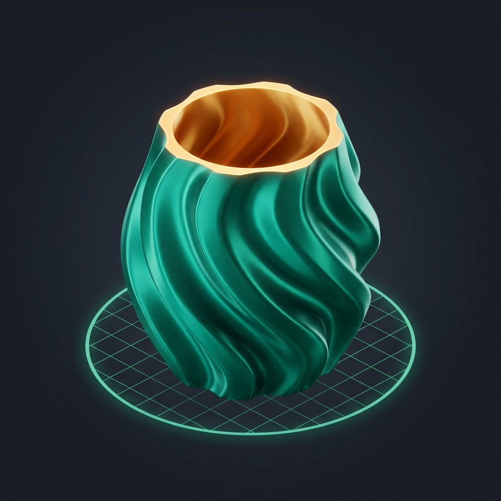

<p align="center">
  
</p>

<h1 align="center">Orca Vase Studio (<code>v1.3.1</code>)</h1>

<p align="center">
  <strong>Native Parametric 3D Vase &amp; Botanical Planter Studio Inside OrcaSlicer 2.5.1+</strong><br/>
  <em>Estúdio Paramétrico 3D Nativo de Vasos &amp; Cachepôs Dentro do OrcaSlicer 2.5.1+</em>
</p>

<p align="center">
  
  &nbsp;
  <a href="#english-overview"><strong>🇺🇸 English</strong></a>
  &nbsp;·&nbsp;
  <a href="#visão-geral-português-pt-br"><strong>🇧🇷 Português (PT-BR)</strong></a>
  &nbsp;·&nbsp;
  <a href="docs/MANUAL_EN.md"><strong>📖 User Manual (EN)</strong></a>
  &nbsp;·&nbsp;
  <a href="docs/MANUAL_PT-BR.md"><strong>📘 Manual de Uso (PT-BR)</strong></a>
  &nbsp;·&nbsp;
  <a href="docs/COMMUNITY_LISTING.md"><strong>🚀 Marketplace &amp; Publishing Kit</strong></a>
</p>

---

## Version 1.3.1 · Fitas mais próximas do vaso / Closer-fitting ribbons

**Achatamento das fitas (0–60%)** aproxima as dobras do corpo do vaso,
mantendo a espessura existente. Comece em 30–50% e confira a prévia fatiada.
0% preserva a forma publicada na versão 1.3.0. Combinações que comprimam
demais as dobras são bloqueadas com uma indicação de ajuste.

**Ribbon Flattening (0–60%)** brings folds closer to the cup while preserving
their existing thickness. Start at 30–50% and inspect the sliced preview.
This reduces projection; steep overhangs can remain. Physical printing has
not been validated. See [controls and measured limitations](docs/RIBBON_FLATTENING.md).

## Version 1.3.0 · Padrões geométricos / Geometric patterns

Sete novos estilos de superfície: **losangos, escamas, crateras, pétalas dobradas,
flor em espiral, anéis e coral**, com repetição, torção e intensidades
independentes na base, meio e topo. Disponíveis na aba e no painel lateral,
nos sete idiomas. Os quatro efeitos anteriores continuam combináveis.

Folded Petals uses actual curled ribbons around a hollow cup, with width,
thickness, curl, overlap, stretch and four quality levels. The other six
patterns remain wall reliefs.

Seven new sidewall patterns with signed depth, repetition, twist and independent
bottom/middle/top strength. Existing preset geometry stays unchanged when the
layer is disabled. See [usage, provenance and validation](docs/GEOMETRIC_PATTERNS.md).

## Version 1.2.0 · Idiomas e otimização

The header now provides seven fully offline interface languages: **Português, English, Español, Italiano, Français, Deutsch and 日本語**. The host language is detected automatically; an explicit selection is saved and shared between the main tab and dock. Built-in preset descriptions, parameter names, warnings and export messages are translated. Personal names, printer profiles, filenames and manufacturing values are preserved. Unsupported system languages use English. Technical errors from the engine remain verbatim when there is no translated message.

O cabeçalho agora oferece sete idiomas offline. A escolha é salva e sincronizada entre aba e painel; sem escolha manual, segue o idioma do OrcaSlicer. Os textos foram preparados com terminologia de impressão 3D e ainda aceitam revisão de falantes nativos. Os manuais completos continuam em PT/EN.

Each language is now an independent JSON file. Add one file under `src/vase_studio/locales/` and rebuild: both standalone installers and the wheel discover it automatically, with regional matching and English fallback. See [adding language packs / adicionar idiomas](docs/LANGUAGE_PACKS.md).

The standalone installer stores the immutable HTML template with lossless standard-library compression; the wheel keeps readable source modules. Wireframe vertices are created/uploaded only while wireframe is enabled and released when it is disabled. All twelve published preset vases and the botanical saucer preserve the original vertex, triangle and normal bytes. See [languages and measured optimization](docs/MULTILINGUAL_AND_PERFORMANCE.md). Install one format only, activate it, close and reopen OrcaSlicer. No installer or test updates an existing Orca installation unless installation is explicitly requested.

## English Overview

**Orca Vase Studio (`orca-vase-studio` v1.3.1)** is a self-contained, single-file native Python plugin for **OrcaSlicer 2.5.1+** that embeds an interactive **WebGL2 + 2D PCHIP Curve** parametric studio right inside the slicer. Design sculptural vases, thick-walled ceramic vessels (`0.8–25.0 mm`), and botanical planters with drainage holes and matching drip saucers — then inject them directly onto your active OrcaSlicer build plate in **1 click** with automatic slicer configuration.

### Key Highlights (`v1.3.1`)

- **Dual Native OrcaSlicer Integration:**
  - **Top-Bar Studio Tab (`Vase Studio`):** Full 3-column workspace right beside *Prepare / Preview / Device*.
  - **Right-Docked Side Panel (`Orca Vase Studio - Painel Lateral`):** Compact tabbed studio docked directly next to the 3D Plater (*File → Plugins*).
- **Parametric Sliders + 2D PCHIP Freeform Curve Editor:** Sculpt via dimensional sliders and 3–24-sided polygonal cross-sections, or convert in 1 click to a smooth monotonic 2D PCHIP curve with interactive knot editing.
- **5 Combinable Surface Layers:** Stack **Ribbed / Fluted**, **Organic Waves**, **Origami Diamond (Yoshimura)**, **Cellular / Coral 3D**, and **Geometric Relief** with exact millimeter depth, density, spacing, sharpness, helical twist (`±720°`), and smooth bottom/top fade zones (`< 1e-12 mm` JS-to-Python math parity).
- **`🔬 X-Ray / Wall` Mode, Live `mm` CAD Calipers & Horizontal `Z` Slice:** Translucent dual-pass X-Ray shader, projected CAD callouts (`Ø Outer`, `Ø Bore`, `Wall`, `Bottom`), vertical `Y` profile cut, horizontal `Z` plan slice (`5%–100%`), and real-time Overhang Heatmap (`°`).
- **True Open-Mouth Hollow Shells (`0.8–25.0 mm`) + Protected Spiral Vase Mode:** Generates watertight 2-manifold open-mouthed hollow meshes by default, plus single-extrusion Spiral Mode with an automatic `.STL` open-mouth guard (`stl_always_open_hollow`).
- **Drainage Holes & Matching Saucer:** 1–9 bottom drainage holes (through-floor tunnels in hollow mode or smart blind base cavities in Spiral Vase mode!) + custom-fitted textured drip saucer with raised inner ribs.
- **1-Click In-Memory Plater Injection (`WM_COPYDATA`):** Zero extra subprocesses, zero network calls (100% offline), and automatic background updates for wall loops, bottom layers, or Spiral Vase settings.
- **100% Self-Contained Single-File Distribution:** Installing `dist/orca_vase_generator.py` alone automatically materializes its crisp 64×64 vector tab icon (`icon.svg`) inside plugin storage!

### Quick Installation (10 Seconds)

1. Grab **`dist/orca_vase_generator.py`** (or download `orca_vase_generator.py` from [**GitHub Releases**](https://github.com/victorFernande/orca-vase-generator/releases)).
2. In **OrcaSlicer 2.5.1+**, click **File → Plugins → Install local plugin...** and select `orca_vase_generator.py`.
3. Enable **Orca Vase Studio** under **Plugins → Manage Plugins**, approve local plugin folder permissions, and open the new top tab!

👉 **Full step-by-step guide:** [**Quick User Manual (`docs/MANUAL_EN.md`)**](docs/MANUAL_EN.md)

---

## Visão Geral (Português PT-BR)

O **Orca Vase Studio (`orca-vase-studio` v1.3.1)** é um plugin nativo em Python de **arquivo único autossuficiente** para o **OrcaSlicer 2.5.1+** que adiciona um estúdio paramétrico 3D interativo (**WebGL2 + Curva Livre 2D PCHIP**, 100% offline) dentro do próprio fatiador. Crie vasos decorativos, peças cerâmicas de parede espessa (`0,8–25,0 mm`) e cachepôs com furos de drenagem e pratinho coletor, enviando tudo em **1 clique** direto para a mesa (*Plater*) com ajuste automático do fatiamento.

### Principais Recursos (`v1.3.1`)

- **Dupla Integração Nativa no OrcaSlicer:**
  - **Aba Superior (`Vase Studio`):** Estúdio amplo em 3 colunas ao lado de *Preparar / Visualizar / Dispositivo*.
  - **Painel Lateral Acoplado (`Orca Vase Studio - Painel Lateral`):** Painel compacto acoplado à direita da mesa 3D (*Arquivo → Plugins*).
- **Silhueta Paramétrica + Curva Livre 2D (PCHIP):** Modele por sliders e seções poligonais (3 a 24 lados) ou converta em 1 clique para uma curva livre PCHIP sem oscilações indesejadas.
- **5 Camadas Combináveis de Textura Dimensional:** Combine **Canelado / Frisos**, **Ondas Orgânicas**, **Origami Diamante (Yoshimura)** **Celular / Coral 3D** e **Relevo geométrico** com controle exato de profundidade (`mm`), densidade, espaçamento, nitidez, torção helicoidal (`±720°`) e suavização na base/topo.
- **Modo `🔬 Raio-X / Parede`, Calibre CAD em `mm` & Fatia Horizontal `Z`:** Veja a cavidade oca e o fundo por dentro, confira cotas reais projetadas (`Ø Externo`, `Ø Furo`, `Parede` e `Fundo`), use o Corte Vertical (`Perfil Y`), a Fatia Horizontal (`Planta Z` de `5%` a `100%`) e o Mapa de Overhang (`°`).
- **Vaso Oco Real com Boca Aberta (`0,8–25,0 mm`) + Modo Espiral Protegido:** Malhas 2-manifold estanques com abertura real no topo por padrão e trava inteligente (`Manter boca aberta ao exportar .STL`) para nunca fechar o furo de um `.STL` acidentalmente.
- **Furos de Drenagem & Pratinho Coletor:** De 1 a 9 furos de drenagem (túneis reais no vaso oco ou cavidades cegas inteligentes nas camadas sólidas do Modo Espiral!) + pratinho sob medida com nervuras internas e textura coordenada.
- **Envio Instantâneo em Memória para a Bandeja (`WM_COPYDATA`):** Injeta os objetos diretamente na instância ativa do OrcaSlicer sem abrir janelas extras e configura paredes, camadas de fundo ou Modo Espiral automaticamente em segundo plano.
- **Arquivo Único `.py` com Ícone Embutido:** Mesmo instalando apenas `orca_vase_generator.py` localmente, o plugin materializa automaticamente seu próprio `icon.svg` vetorial 64×64!

### Instalação Rápida (10 Segundos)

1. Baixe o arquivo único **`dist/orca_vase_generator.py`** (ou na aba [**Releases do GitHub**](https://github.com/victorFernande/orca-vase-generator/releases)).
2. No **OrcaSlicer 2.5.1+**, acesse **Arquivo → Plugins → Instalar plugin local...** e escolha `orca_vase_generator.py`.
3. Ative **Orca Vase Studio** em **Plugins → Gerenciar Plugins**, aprove as permissões locais da pasta do plugin e clique na aba **Vase Studio**!

👉 **Guia completo passo a passo:** [**Mini Manual de Uso (`docs/MANUAL_PT-BR.md`)**](docs/MANUAL_PT-BR.md)

---

## Documentation & Community Kit / Documentação

| Document / Documento | Description / Descrição |
| :--- | :--- |
| [**`docs/MANUAL_EN.md`**](docs/MANUAL_EN.md) | Complete Quick User Manual in English (Installation, 2D Curve, Textures, X-Ray/Z-Slice, Hollow vs. Spiral, Drainage & 1-Click Plater). |
| [**`docs/MANUAL_PT-BR.md`**](docs/MANUAL_PT-BR.md) | Mini Manual de Uso completo em Português (Instalação, Curva 2D, Texturas, Raio-X/Fatia Z, Vaso Oco vs. Espiral, Drenagem e Envio à Mesa). |
| [**`docs/COMMUNITY_LISTING.md`**](docs/COMMUNITY_LISTING.md) | Ready-to-paste PT-BR & EN Marketplace descriptions, Reddit/Discord/MakerWorld announcements, GitHub Topics, and step-by-step release checklist. |
| [**`docs/orcacloud/README.md`**](docs/orcacloud/README.md) | Illustrated PT/EN OrcaCloud presentation, eight 1600×900 banners, and ready-to-paste bilingual description. |

---

## Project Structure / Estrutura do Repositório

```text
orca-vase-generator/
├── .github/workflows/
│   ├── ci.yml                     # Cross-platform CI (Linux, Windows, macOS) + Release Assets
│   └── publish-orcacloud.yml      # GitHub OIDC Trusted Publishing to OrcaCloud Plugin Hub
├── pyproject.toml
├── LICENSE
├── README.md
├── assets/
│   ├── icon.jpg                   # High-res showcase artwork for GitHub & Marketplace
│   ├── icon.png                   # 512x512 PNG icon for Marketplace / OrcaCloud
│   └── icon.svg                   # Crisp 64x64 transparent vector icon (dark & light UI native)
├── docs/
│   ├── MANUAL_EN.md               # Quick User Manual (English)
│   ├── MANUAL_PT-BR.md            # Mini Manual de Uso (Português PT-BR)
│   └── COMMUNITY_LISTING.md       # Store copy, OrcaCloud OIDC guide & announcements (PT-BR & EN)
├── scripts/
│   └── build_and_install.py       # Single-file PEP 723 bundler + wheel builder + local installer
├── src/
│   └── vase_studio/
│       ├── __init__.py
│       ├── schema.py              # Unified parameter schema & safe normalization (walls up to 25 mm)
│       ├── mesh_generator.py      # Watertight 2-manifold NumPy engine (hollow, spiral & saucer)
│       ├── printability.py        # Overhang trigonometry, volume, filament weight & bed bounds
│       ├── exporters.py           # Binary STL & native OrcaSlicer 2.5.1 3MF project writers
│       ├── presets_catalog.py     # 12 bilingual curated presets, user CRUD & printable randomizer
│       ├── studio_ui.py           # Offline HTML5 + CSS3 + WebGL2 + X-Ray + CAD Calipers UI
│       ├── plugin_main.py         # Native `orca` bridge + auto-materialized SVG icon + WM_COPYDATA IPC
│       └── icon.svg               # Source 64x64 vector tab icon
├── dist/
│   ├── orca_vase_generator.py     # Ready-to-distribute PEP 723 single-file plugin bundle (v1.3.0)
│   ├── orca_vase_generator_any.py # Universal `_any` PEP 723 bundle for OrcaCloud publishing
│   └── orca_vase_generator-1.3.0-py3-none-any.whl
└── tests/                         # 26/26 topology, 3MF/STL, JS-Python parity & bridge QA tests
```

---

## Build & Automated Verification / Compilação e Testes

Build the single-file PEP 723 bundles (`dist/orca_vase_generator.py` + `dist/orca_vase_generator_any.py`), build the universal wheel, verify standalone smoke loading, and deploy locally into `%APPDATA%\OrcaSlicer\orca_plugins\orca_vase_generator\` (pass `--no-install` on CI):

```powershell
& "C:\Program Files\OrcaSlicer\python\python.exe" -B scripts\build_and_install.py
```

Run the full automated QA suite (`26/26` tests with `-W error`, verifying strict 2-manifold Euler topology, WebGL2 JS-vs-Python `< 1e-12 mm` surface parity, standalone icon auto-materialization, `.STL` open-mouth guard, and `WM_COPYDATA` IPC):

```powershell
& "C:\Program Files\OrcaSlicer\python\python.exe" -W error -m unittest discover -s tests -v
```

---

## License / Licença

Released under the **MIT License**. Made for the **OrcaSlicer** 3D printing community.
