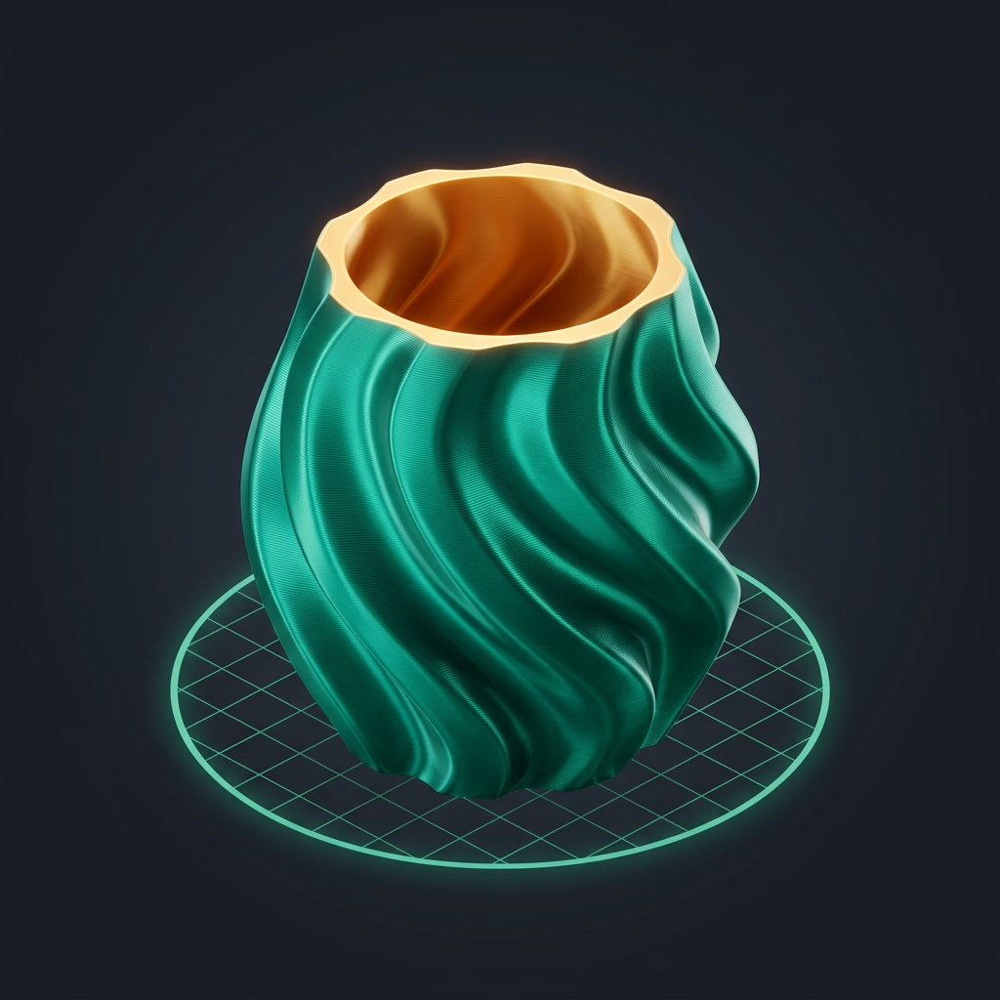

# Orca Vase Studio — Community Publishing & Marketplace Kit (PT-BR & EN)

<p align="center">
  
  &nbsp;&nbsp;&nbsp;&nbsp;
  
</p>

Este documento reúne todos os textos prontos para copiar e colar (**Português PT-BR** e **English EN**) para publicar o **Orca Vase Studio (`v1.1.1`)** no GitHub, no **OrcaSlicer Plugin Marketplace** e nas comunidades de impressão 3D (Reddit, Discord, Fóruns, Printables e MakerWorld).

This document provides ready-to-paste copy in both **Brazilian Portuguese (PT-BR)** and **English (EN)** to publish **Orca Vase Studio (`v1.1.1`)** on GitHub, the **OrcaSlicer Plugin Marketplace**, and 3D printing communities.

---

## Sumário / Contents

1. [Metadados, Categoria & GitHub Topics](#1-metadados-categoria--github-topics)
2. [Português (PT-BR) — Catálogo, Loja & Anúncio na Comunidade](#2-português-pt-br--catálogo-loja--anúncio-na-comunidade)
3. [English (EN) — Store Listing & Community Announcement](#3-english-en--store-listing--community-announcement)
4. [Checklist Passo a Passo de Publicação (GitHub + OrcaSlicer Marketplace)](#4-checklist-passo-a-passo-de-publicação-github--orcaslicer-marketplace)

---

## 1. Metadados, Categoria & GitHub Topics

| Campo / Field | Valor / Value |
| :--- | :--- |
| **Plugin ID (`[tool.orcaslicer.plugin].id`)** | `orca-vase-studio` |
| **Plugin Name** | `Orca Vase Studio` |
| **GitHub Repository** | `https://github.com/victorFernande/orca-vase-generator` |
| **Bundle Filename (Single-File PEP 723)** | `orca_vase_generator.py` *(com ícone vetorial `icon.svg` auto-materializado!)* |
| **OrcaCloud Universal Bundle (`_any`)** | `orca_vase_generator_any.py` |
| **Universal Wheel Package** | `orca_vase_generator-1.1.1-py3-none-any.whl` |
| **Version** | `1.1.1` |
| **Requires OrcaSlicer** | `2.5.1+` (Embedded Python `>=3.12`, `numpy>=1.26`) |
| **Marketplace Category** | `3D Modeling & Generators` / `CAD & Parametric Design` |
| **License** | `MIT` |

### GitHub Topics (copiar e colar / copy-paste)

```text
orca-plugin, orcaslicer, 3d-printing, vase-generator, parametric-design, planter, stl-generator, webgl2
```

---

## 2. Português (PT-BR) — Catálogo, Loja & Anúncio na Comunidade

### 2.1 Nome & Frase de Impacto (Tagline — 1 frase)

- **Nome do Plugin:** `Orca Vase Studio`
- **Tagline (PT-BR):** Estúdio paramétrico 3D nativo para OrcaSlicer que cria vasos esculturais de parede real em milímetros e cachepôs com drenagem e prato coletor, enviando direto para a mesa em 1 clique.

### 2.2 Descrição Curta para o Catálogo (~250 caracteres)

> *(239 caracteres)*
```text
Estúdio 3D nativo de vasos e cachepôs para OrcaSlicer: curva 2D PCHIP, 4 texturas combináveis, Raio-X com cotas CAD em mm, corte Z, parede real até 25 mm (ou Modo Espiral), drenagem + pratinho e envio em 1 clique direto para a bandeja.
```

### 2.3 Descrição Completa para Loja / Marketplace (PT-BR)

```markdown
### Orca Vase Studio — Estúdio Paramétrico 3D de Vasos & Cachepôs dentro do OrcaSlicer

Crie vasos decorativos, peças cerâmicas de parede espessa e cachepôs funcionais para jardinagem sem sair do **OrcaSlicer 2.5.1+**. O **Orca Vase Studio** roda 100% offline em 60 FPS (WebGL2 + motor matemático NumPy 2-manifold estanque) tanto como **Aba Superior (`Gerador de Vasos`)** quanto como **Painel Lateral acoplado à direita da mesa 3D**.

#### Destaques Principais

- **Silhueta Paramétrica + Editor de Curva Livre 2D (PCHIP):** Modele rapidamente por sliders (base, bojo, cintura, pescoço, abertura de borda, chanfro e seções poligonais de 3 a 24 lados) ou converta em 1 clique para uma **Curva Livre PCHIP** sem oscilações indesejadas, arrastando nós em tempo real.
- **4 Camadas Combináveis de Textura Dimensional:** Misture livremente **Canelado / Frisos**, **Ondas Orgânicas**, **Origami Diamante (Yoshimura)** e **Celular / Coral 3D**, controlando profundidade em `mm`, densidade, espaçamento, nitidez dos vincos, torção helicoidal (`±720°`) e suavização automática na base/topo para adesão perfeita na mesa.
- **Modo `🔬 Raio-X / Parede`, Calibre CAD em `mm` & Fatia Horizontal `Z`:** Enxergue a cavidade interna translúcida em contraste quente, confira cotas reais projetadas na tela (`Ø Externo`, `Ø Furo`, `Parede` e `Fundo` em milímetros) e inspecione a parede cortada com **Corte Vertical (`Perfil Y`)** ou **Fatia Horizontal (`Planta Z` de 5% a 100%)**, além de **Mapa Térmico de Overhang (°)**.
- **Vaso Oco Real com Boca Aberta (`0,8 mm` a `25,0 mm`) + Modo Espiral:** Gere malhas `.STL` e `.3MF` genuinamente ocas com abertura real no topo e paredes estruturais robustas até `25 mm` — ou alterne para o **Modo Espiral (1 Linha)** com proteção automática (`Manter boca aberta ao exportar .STL`) para nunca exportar um bloco fechado por acidente.
- **Jardinagem Completa (Drenagem + Pratinho Coletor):** Adicione de 1 a 9 furos de drenagem (túneis 2-manifold reais no vaso oco ou cavidades cegas inteligentes na base sólida do Modo Espiral!) e gere um **Pratinho Coordenado** com nervuras internas elevadas e a mesma textura do vaso.
- **Envio Instantâneo em 1 Clique para a Mesa (*Plater*):** Injeta vaso e pratinho diretamente na janela ativa do OrcaSlicer (zero subprocessos extras) e ajusta automaticamente voltas de parede, camadas de fundo ou Modo Espiral para a sua impressora e bico ativos.
- **12 Presets Curados + Botão "Surpreenda-me":** Galeria bilíngue pronta para imprimir, salvamento de presets próprios e gerador aleatório inteligente com controle de overhang.
```

### 2.4 Anúncio Pronto para Comunidades (Reddit / Discord / Fóruns / Printables / MakerWorld — PT-BR)

```markdown
🚀 **[Plugin Gratuito / Open-Source] Orca Vase Studio v1.1.1 — Crie vasos esculturais e cachepôs com drenagem direto dentro do OrcaSlicer!**

Fala, pessoal! Acabei de lançar o **Orca Vase Studio (`v1.1.1`)**, um plugin nativo em arquivo único para o **OrcaSlicer 2.5.1+** que adiciona uma aba completa (e painel lateral!) de modelagem paramétrica 3D de vasos, peças arquitetônicas e cachepôs de plantas sem precisar abrir CAD externo.

✨ **O que ele faz direto dentro do fatiador:**
- 🎨 **Silhueta + Curva Livre 2D (PCHIP) em 60 FPS:** Comece por 12 presets prontos, use o botão *"Surpreenda-me"* ou desenhe a silhueta arrastando pontos na curva 2D.
- 🌊 **4 Texturas Combináveis:** Empilhe *Canelado/Frisos*, *Ondas Orgânicas*, *Origami Yoshimura* e *Celular/Coral 3D* com controle exato em milímetros de relevo, densidade, nitidez e torção helicoidal.
- 🔬 **Modo Raio-X, Cotas CAD em `mm` e Fatia Horizontal Z:** Veja por dentro da peça antes de fatiar! Mostra `Ø Externo`, `Ø Furo da Boca`, espessura real da `Parede` e `Fundo`, além de mapa de Overhang em graus.
- 🏺 **Vaso Oco Real (parede de `0,8 mm` até `25 mm`!) + Modo Espiral:** Todos os modelos saem com boca realmente aberta e parede física em milímetros — e mesmo se você estiver testando o Modo Espiral, a trava de proteção garante que seus `.STL` continuem abertos no topo.
- 🌱 **Jardinagem Pronta:** Furos de drenagem na base (inclusive cavidades inteligentes compatíveis com Modo Espiral!) + geração automática de **Pratinho Coletor** combinando com a textura do vaso.
- ⚡ **1 Clique para a Mesa (Plater):** Envia direto para a bandeja ativa do OrcaSlicer e já configura paredes, camadas de fundo ou Modo Espiral de acordo com seu bico atual.

📦 **Instalação em 10 segundos (Arquivo Único!):**
1. Baixe apenas o arquivo `orca_vase_generator.py` na aba Releases do GitHub (o ícone vetorial da aba já vem embutido dentro dele!).
2. No OrcaSlicer 2.5.1+, vá em **Arquivo → Plugins → Instalar plugin local...** (*File → Plugins → Install local plugin...*) e selecione `orca_vase_generator.py`.
3. Ative em **Plugins → Gerenciar Plugins** e clique na nova aba superior **Gerador de Vasos**!

🔗 **Download & Código-Fonte (MIT):** https://github.com/victorFernande/orca-vase-generator

Feedbacks, fotos de vasos impressos e sugestões de novas texturas são super bem-vindos! 🙌
```

---

## 3. English (EN) — Store Listing & Community Announcement

### 3.1 Plugin Name & Tagline (1-Sentence Summary)

- **Plugin Name:** `Orca Vase Studio`
- **Tagline (EN):** Native 3D parametric vase and planter studio inside OrcaSlicer with real millimeter walls, X-Ray CAD calipers, drainage + matching saucer, and 1-click Plater injection.

### 3.2 Short Catalog Description (~250 characters)

> *(244 characters)*
```text
Native 3D vase & planter studio inside OrcaSlicer: 2D PCHIP curve editor, 4 combinable textures, X-Ray & mm CAD calipers, Z-slice inspector, open-mouth hollow STL walls up to 25 mm + Spiral mode, drainage + saucer, and 1-click Plater send.
```

### 3.3 Full Store / Marketplace Description (EN)

```markdown
### Orca Vase Studio — Parametric 3D Vase & Planter Design Studio Inside OrcaSlicer

Design sculptural vases, thick-walled ceramic vessels, and functional botanical planters without ever leaving **OrcaSlicer 2.5.1+**. **Orca Vase Studio** runs 100% offline at 60 FPS (WebGL2 viewport + watertight 2-manifold NumPy geometry engine) as both a full **Top-Bar Studio Tab (`Gerador de Vasos`)** and a **Right-Docked Side Panel** directly beside your 3D Plater.

#### Key Capabilities

- **Parametric Silhouette + 2D PCHIP Freeform Curve Editor:** Sculpt effortlessly using dimensional sliders (base, belly, waist, neck, lip flare, rim bevel, and 3-to-24-sided polygonal cross-sections) or convert in one click to a monotonic **2D PCHIP Freeform Curve** with interactive knot dragging and zero spline overshoot.
- **4 Combinable Dimensional Surface Textures:** Layer **Ribbed / Fluted**, **Organic Waves**, **Origami Diamond (Yoshimura)**, and **Cellular / Coral 3D** simultaneously with exact control over depth (`mm`), density, duty cycle/spacing, crest sharpness, helical twist (`±720°`), and smooth bottom/top fade zones for rock-solid bed adhesion.
- **`🔬 X-Ray / Wall` Shader, Live `mm` CAD Calipers & Horizontal `Z` Slice:** Inspect internal cavity geometry before slicing with a dual-pass translucent X-Ray shader, live projected CAD dimension callouts (`Ø Outer`, `Ø Bore`, `Wall`, and `Bottom` in `mm`), **Vertical Profile Cut (`Y`)**, **Horizontal Plan Slice (`Z` 5%–100%)**, and a real-time **Overhang Heatmap (°)**.
- **True Open-Mouth Hollow `.STL` (`0.8 mm` – `25.0 mm` Walls) + Spiral Vase Mode:** Generates genuinely open-mouthed, watertight hollow shells up to `25 mm` thick by default — plus single-extrusion **Spiral Mode** with an automatic `.STL` open-mouth safety guard (`Always keep open mouth on .STL export`) so exported `.STL` files never unexpectedly seal the top opening.
- **Botanical Planter Ready (Drainage Holes + Matching Saucer):** Add 1 to 9 bottom drainage holes (watertight through-floor tunnels in hollow mode, or smart blind base cavities that preserve single-contour Spiral Vase slicing!) and generate a **Matching Drip Saucer** with raised inner drainage ribs and coordinated exterior texture.
- **1-Click Direct Plater Injection & Auto-Slicer Setup:** Sends your vase (and optional saucer) straight into the active OrcaSlicer window in memory (zero extra subprocesses) while automatically configuring wall loops, bottom shell layers, or Spiral Vase settings for your active nozzle and layer height.
- **12 Curated Bilingual Presets + Smart "Surprise Me" Generator:** Instant inspiration across organic, architectural, geometric, ceramic, and planter styles, plus custom preset saving.
```

### 3.4 Ready-to-Post Community Announcement (Reddit / Discord / Forum / Printables / MakerWorld — EN)

```markdown
🚀 **[Free & Open-Source Plugin] Orca Vase Studio v1.1.1 — Design Sculptural Vases & Planters with Drainage Right Inside OrcaSlicer!**

Hey everyone! I built **Orca Vase Studio (`v1.1.1`)**, a self-contained single-file native Python plugin for **OrcaSlicer 2.5.1+** that adds a full 60 FPS WebGL2 parametric vase & planter studio right inside the slicer (both as a top-bar tab and a dockable side panel!).

✨ **Highlights:**
- 🎨 **Parametric Sliders + 2D PCHIP Curve Editor:** Start from 12 curated presets, hit *"Surprise Me"*, or drag knots directly on a smooth 2D silhouette curve.
- 🌊 **4 Stackable Surface Textures:** Combine *Ribbed/Fluted*, *Organic Waves*, *Yoshimura Origami Diamonds*, and *3D Cellular Coral* with exact millimeter depth, spacing, sharpness, and helical twist controls.
- 🔬 **X-Ray Wall Inspector, `mm` CAD Calipers & Z-Slice Cut:** See inside the shell in real time with live `Ø Outer`, `Ø Mouth Bore`, `Wall`, and `Bottom` millimeter callouts, horizontal Z-plan slicing, and an Overhang Heatmap (°).
- 🏺 **True Open-Mouth Hollow Shells (`0.8–25 mm` walls) + Spiral Mode:** Exports real open-mouthed watertight hollow `.STL` & `.3MF` meshes up to `25 mm` thick — plus Spiral Vase mode with an automatic `.STL` open-mouth guard so you never accidentally export a capped solid block.
- 🌱 **Drainage Holes & Matching Saucer:** Add 1–9 bottom drainage holes (including smart blind base cavities that work even in Spiral Vase mode!) and generate a matching textured drip saucer with raised inner ribs.
- ⚡ **1-Click Send to Plater:** Injects your model directly into the active OrcaSlicer build plate and automatically configures wall loops, bottom layers, or Spiral Vase parameters for your active printer profile.

📦 **10-Second Single-File Install:**
1. Download `orca_vase_generator.py` from GitHub Releases (100% self-contained — it even auto-materializes its own vector tab icon!).
2. In OrcaSlicer 2.5.1+, open **File → Plugins → Install local plugin...** and pick `orca_vase_generator.py`.
3. Enable **Orca Vase Studio** in **Plugins → Manage Plugins** and click the new top tab!

🔗 **GitHub Release & Source (MIT):** https://github.com/victorFernande/orca-vase-generator

Would love to see what prints you create with it — feedback and texture ideas are super welcome! 🙌
```

---

## 4. Checklist Passo a Passo de Publicação (GitHub + OrcaSlicer Marketplace)

Siga este roteiro rápido para publicar o **Orca Vase Studio** para a comunidade mundial:

### Etapa A — Preparar o Repositório Público no GitHub

- [x] **1. Repositório público no GitHub:** `https://github.com/victorFernande/orca-vase-generator` com licença **MIT**.
- [x] **2. Garantir que os bundles `dist/orca_vase_generator.py`, `dist/orca_vase_generator_any.py` e `.whl` estão atualizados e validados:**
  ```powershell
  & "C:\Program Files\OrcaSlicer\python\python.exe" -B scripts\build_and_install.py
  & "C:\Program Files\OrcaSlicer\python\python.exe" -W error -m unittest discover -s tests -v
  ```
- [x] **3. Subir os arquivos do projeto para a branch `main`:**
  - Incluir `.github/workflows/`, `src/`, `scripts/`, `tests/`, `docs/`, `assets/icon.jpg`, `assets/icon.png`, `assets/icon.svg`, `dist/orca_vase_generator.py`, `dist/orca_vase_generator_any.py`, `dist/orca_vase_generator-1.1.1-py3-none-any.whl`, `LICENSE`, `pyproject.toml` e `README.md`.
- [x] **4. Configurar "About" e GitHub Topics (Essencial para descoberta!):**
  - Em **Description**, usar a frase curta de catálogo (Seção 3.2).
  - Em **Topics**, adicionar:
    - `orca-plugin`, `orcaslicer`, `3d-printing`, `vase-generator`, `parametric-design`, `planter`, `stl-generator`, `webgl2`

### Etapa B — Criar um GitHub Release Oficial (`v1.1.1`)

- [x] **5. Criar a Tag e Release `v1.1.1`:**
  - Tag: `v1.1.1` | Título: `Orca Vase Studio v1.1.1 — Parametric 3D Vase & Planter Studio`.
  - Na descrição do Release, incluir a descrição bilíngue (PT-BR + EN).
- [x] **6. Anexar os Artefatos de Instalação (`Attach binaries` — automatizado via `.github/workflows/ci.yml`):**
  - `dist/orca_vase_generator.py` *(bundle PEP 723 de arquivo único para instalação local direta com `icon.svg` auto-materializado)*
  - `dist/orca_vase_generator_any.py` *(bundle universal `_any` exigido pela API do OrcaCloud)*
  - `dist/orca_vase_generator-1.1.1-py3-none-any.whl` *(pacote wheel PEP 427 puro-Python)*
  - `src/vase_studio/icon.svg` *(ícone vetorial 64×64)*

### Etapa C — Publicação Automática no OrcaCloud Plugin Hub (GitHub OIDC Trusted Publishing)

O repositório já inclui o workflow oficial **`.github/workflows/publish-orcacloud.yml`**, idêntico ao usado no `victorFernande/orca-gear-generator`, que autentica via **GitHub Actions OIDC (`audience=orcacloud`)** sem precisar salvar chaves/tokens estáticos em *GitHub Secrets*!

- [ ] **7. Cadastrar o Repositório como Trusted Publisher no OrcaCloud:**
  1. Acesse o painel de plugins da sua conta no **OrcaCloud / OrcaSlicer Plugin Hub** (`orcaslicer.com`).
  2. Crie o plugin (slug sugerido: `orca-vase-generator` ou `orca-vase-studio`), envie o ícone de vitrine **`assets/icon.png`** (`512×512`) / **`assets/icon.jpg`** e cole a descrição bilíngue (`[EN-US]` Seção 3.4 + `[PT-BR]` Seção 2.4).
  3. Na aba **Publishing / Trusted Publishers (GitHub Actions OIDC)** do plugin no OrcaCloud, preencha exatamente:
     | Campo no OrcaCloud | Valor Exato |
     | :--- | :--- |
     | **GitHub Owner / Organization** | `victorFernande` |
     | **Repository Name** | `orca-vase-generator` |
     | **Workflow Filename** | `publish-orcacloud.yml` |
     | **Environment Name** | *(deixe em branco / empty)* |
  4. Assim que o Trusted Publisher estiver salvo no OrcaCloud, re-execute o workflow da release `v1.1.1` com 1 comando (ou clique em **Re-run all jobs** na aba *Actions → Publish to OrcaCloud* em `https://github.com/victorFernande/orca-vase-generator/actions`):
     ```powershell
     gh run list -R victorFernande/orca-vase-generator --workflow publish-orcacloud.yml
     gh run rerun <RUN_ID> -R victorFernande/orca-vase-generator
     ```
     O workflow irá gerar um token OIDC (`audience=orcacloud`), compilar e verificar `dist/orca_vase_generator_any.py` e enviar via `POST https://api.orcaslicer.com/api/v1/plugin-publish/releases` retornando `HTTP 201 Created`! Nas próximas versões (`v1.1.2`, `v1.2.0`, etc.), basta publicar o GitHub Release que o OrcaCloud será atualizado automaticamente.
- [ ] **8. Divulgar nas Comunidades:**
  - Publique o anúncio pronto (Seção 2.4 em grupos brasileiros e Seção 3.4 no Reddit `r/OrcaSlicer` / `r/3DPrinting`, Discord oficial do OrcaSlicer e fóruns) acompanhado de `assets/icon.jpg` / `assets/icon.png` e um GIF curto girando o vaso em modo `🔬 Raio-X / Parede`!
