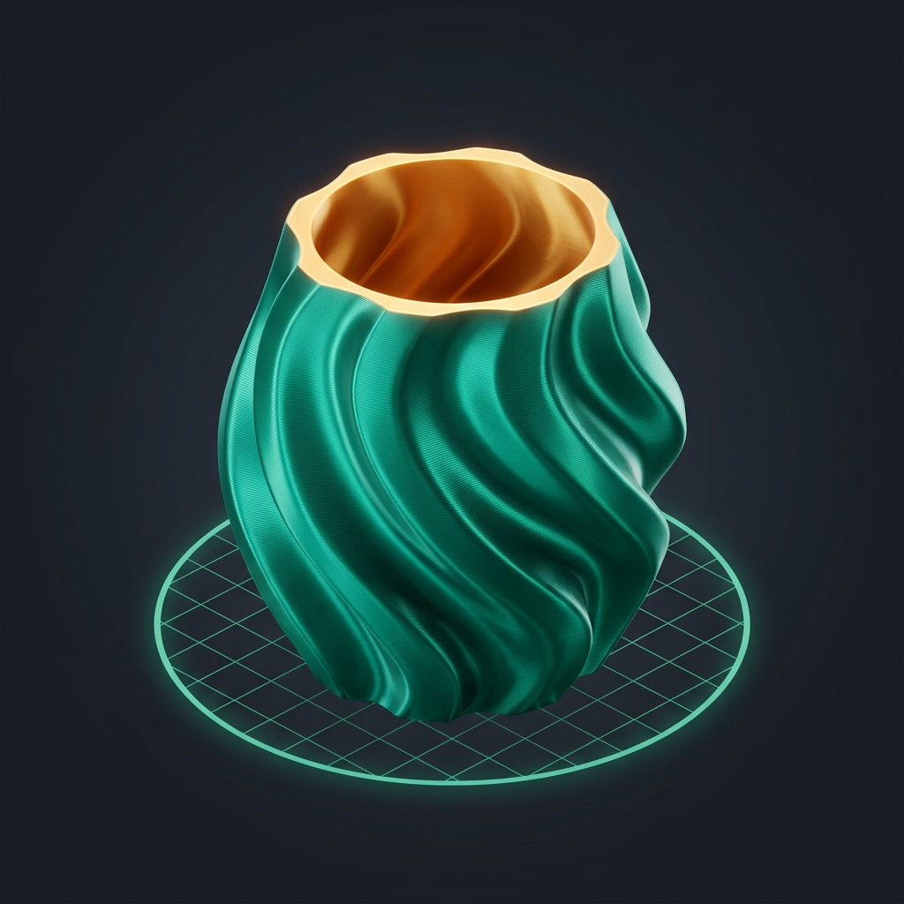

# Quick User Manual — Orca Vase Studio (`v1.3.0`)

The language selector in the header offers Português, English, Español, Italiano, Français, Deutsch and 日本語. Your choice is saved and synchronized between page and dock; see [languages and optimization](MULTILINGUAL_AND_PERFORMANCE.md).

  

> 🇧🇷 **Leia em Português:** [Mini Manual de Uso (`MANUAL_PT-BR.md`)](MANUAL_PT-BR.md)

Welcome to **Orca Vase Studio**! With this native plugin for **OrcaSlicer 2.5.1+**, you can sculpt decorative vases, thick-walled architectural ceramic vessels, and botanical planters with drainage holes and matching drip saucers in real time (100% offline) — and send them straight to the build plate in one click.

---

## 1. Quick Installation

### Option A — 1-Click Local Single-File Install (`.py`)
1. Download the single file **`orca_vase_generator.py`** (located in `dist/` or attached to [GitHub *Releases*](https://github.com/victorFernande/orca-vase-generator/releases)).
   - *No extra files required: the script is 100% self-contained and automatically materializes its own crisp vector `icon.svg`!*
2. In **OrcaSlicer 2.5.1+**, open **File → Plugins → Install local plugin...** and select `orca_vase_generator.py`.
3. Open **Plugins → Manage Plugins**, enable **Orca Vase Studio**, and approve its scoped local storage permissions (`fs_read`, `fs_readwrite`, and `threading`).

### Option B — Via OrcaSlicer Marketplace
1. Open **Plugins → Marketplace** (or **Manage Plugins**) inside OrcaSlicer.
2. Search for **Orca Vase Studio**, click **Install**, and enable the plugin.

---

## 2. Opening the Studio: Top Tab vs. Side Dock Panel

Orca Vase Studio provides **two synchronized workspaces** tailored to how you like to work:

| Workspace | Where to open it | Best for |
| :--- | :--- | :--- |
| **Full Top-Bar Tab (`Gerador de Vasos`)** | Top navigation bar right beside *Prepare / Preview / Device* | Full-screen **3-column design studio**: Preset Gallery & 2D Silhouette on the left, interactive 3D WebGL2 Viewport in the center, and Textures + Wall controls on the right. |
| **Right-Docked Side Panel (`Orca Vase Studio - Painel Lateral`)** | Menu **File → Plugins → Orca Vase Studio - Painel Lateral** | Opens a sleek compact panel docked right beside OrcaSlicer's 3D Plater with quick tabs (**Shape**, **Textures**, **Wall & Print**, **Presets**) — great for iterating right next to your build plate! |

> **Tip:** The top studio bar also gives you an editable **Vase Name**, a live **Active Printer / Nozzle pill** read directly from OrcaSlicer, instant **EN / PT** language toggle, light/dark theme switcher, and the **Surprise Me** button for one-click printable inspiration.

---

## 3. Modeling the Silhouette & 2D Curve

Inside **Silhouette & 2D Curve**, choose your preferred sculpting workflow:

1. **`Sliders` Mode (Fast Parametric Proportions):**
   - Tune **Total Height** (`30–350 mm`), **Base Diameter**, **Belly Diameter & Height Ratio**, **Waist Diameter & Height Ratio**, **Neck Diameter**, **Top Lip Flare**, and **Top Rim Bevel**.
   - You can also drag the colored control handles directly on the 2D silhouette canvas!
2. **`Freeform 2D Curve` Mode (Monotonic PCHIP Spline):**
   - Click **`Sliders → Curve`** to convert your current slider proportions into editable curve knots, or switch straight to **Freeform 2D Curve**.
   - **Drag** any knot to reshape radius and height; **click anywhere on the curve** to insert a new knot; **double-click** (or **right-click**) an interior knot to remove it.
   - Powered by **PCHIP** interpolation, your silhouette stays silky-smooth with zero unwanted spline overshoot or ringing.
3. **Polygonal Cross-Sections & Mesh Resolution:**
   - Set **Polygon Sides** to `0` for a smooth circle, or `3` to `24` for triangular, hexagonal, octagonal, or gem-cut prisms, blending edge crispness with **Polygon Roundness** (`0.0` sharp facets → `1.0` circular).

---

## 4. Customizing Texture Dimensions (Combinable Layers)

**Geometric Relief:** expand this new layer to choose diamonds, leaf scales,
crater cells, folded petals, spiral bloom, ripple rings or coral. Adjust depth,
columns, rows, twist and independent bottom/middle/top strength. Disable the
other effects to isolate the pattern or combine the layers. See the
[controls, limits and tests](GEOMETRIC_PATTERNS.md).

**Folded Petals** builds curled ribbons around a round hollow cup. Adjust
width, thickness, curl, overlap, stretch and stagger; select Draft, Normal,
Fine or Adaptive quality. Fine is the final default. Spiral mode and other
textures are unavailable for this style. Inspect the overlapping solids in
the sliced preview; the estimate includes overlap volume.

You can enable **any single texture or stack all four simultaneously** — radial displacements are summed in exact millimeters with `< 1e-12 mm` parity between the WebGL2 preview and the exported 2-manifold mesh!

First, set **Envelope & Global Twist**:
- **Bottom / Top Texture Fade (`mm`):** Smoothly ramps surface relief from `0 mm` at the build plate (ensuring a 100% flat, rock-solid first layer!) and tapers cleanly near the top rim.
- **Global Helical Twist (`-720°` to `+720°`):** Spirals the entire cross-section and active textures smoothly from base to rim.

### Dimensional Controls per Texture Layer

1. **Ribbed / Fluted (`ribbed`):**
   - *Rib Depth (`mm`):* Positive values raise outward flutes; negative values carve inward grooves.
   - *Rib Count (Density):* Number of flutes around the circumference (`3` to `180`).
   - *Rib Width / Duty Cycle:* Ratio between rib width and flat spacing fillets (`0.10` to `0.90`).
   - *Crest Sharpness:* Blends from `0.0` (soft cosine flutes) to `1.0` (chiseled triangular crests), plus independent *Rib Helical Twist*.
2. **Organic Waves (`waves`):**
   - *Wave Depth (`mm`)* and *Vertical Wavelength (`mm`)* (vertical spacing from crest to crest).
   - *Angular Lobes:* Circumferential wave count (`0` produces pure horizontal lathe rings!).
   - *Counter-Wave Mix:* Blends an opposing helical wave to sculpt woven ripple pockets.
3. **Origami Diamond (`origami`):**
   - *Facet Depth (`mm`)*, *Cells Around* (horizontal density), and *Vertical Tiers*.
   - *Crease Sharpness:* Controls crispness of Yoshimura paper folds, paired with *Row Stagger*.
4. **Cellular / Coral 3D (`cellular`):**
   - *Cellular Depth (`mm`)*, *Angular Cells*, and *Vertical Scale (`mm`)*.
   - *Ridged Coral Veins:* Toggle ON for carved reef/volcanic stone veins, or OFF for soft hammered *wabi-sabi* ceramic dimples, with customizable *Seed* and *Octaves*.

---

## 5. Using `🔬 X-Ray / Wall`, `💿 Horizontal Z Slice` & Overhang Map

Use the floating 3D Viewport toolbar to verify wall geometry and printability before slicing:

- **`🔬 X-Ray / Wall`:** Activates a dual-layer translucent WebGL2 shader revealing the inner hollow bore and solid floor in warm amber contrast inside the outer emerald shell.
- **`📏 mm Calipers`:** Projects live CAD dimensions directly onto the 3D vase: **`Ø Outer`**, **`Ø Bore` (mouth opening)**, **`Wall` thickness**, and **`Bottom` thickness**.
- **`✂ Cross-Section Cut` (`Vertical Cut Y` & `💿 Horizontal Z Slice`):**
  - **`✂ Vertical Cut (Profile Y)`:** Slices the vase vertically down the middle so you can inspect the full wall profile from base to lip.
  - **`💿 Horizontal Z Slice (Plan 5%–100%)`:** Sweep the slice slider vertically like a CT scan to inspect the exact solid wall ring and flute cross-section at any `Z` height!
- **`🔥 Overhang` Heatmap (°):** Colors every face by overhang angle relative to the build plate (green = safe, amber = caution, red = steep). Enable **Auto-Clamp Overhang Slope** in *Wall & Print* to automatically tame steep texture overhangs!

---

## 6. Choosing Open Hollow Wall (`mm`) vs. Spiral Vase

Under **Wall & Opening (mm)**, pick how your vessel is constructed:

### True Hollow Vase (`mm Wall`) — *Recommended Default*
- Generates a **true open-mouthed, watertight hollow shell** with an exact concentric inner cavity.
- Supports **Wall Thickness (`0.8 mm` up to `25.0 mm`)** and **Bottom Thickness (`1.0 mm` up to `25.0 mm`)** — from lightweight 2-loop decorative prints to heavy architectural ceramic vessels!
- Displays a live perimeter hint showing approximate wall loops for your active nozzle and exact inner mouth bore diameter (`Ø mm`).

### Spiral Mode (`1 Line` / *Vase Mode*)
- Designed for ultra-fast, seamless single-extrusion printing (`0.40–1.20 mm` line width).
- **How slicer Spiral Mode works:** Native `.3MF` / direct Plater Spiral slicing uses a solid base block whose top cap is automatically removed by OrcaSlicer (`top_shell_layers = 0`, `sparse_infill_density = 0%`).
- **Automatic `.STL` Open-Mouth Guard:** **`Always keep open mouth on .STL export`** is **enabled by default**! Even while previewing Spiral Mode, clicking `Export .STL` writes a genuine open-mouthed hollow `.STL` so you never accidentally share or open a sealed block in external software.

---

## 7. Drainage Holes & Matching Saucer

Turn any design into a functional botanical planter in seconds:

1. **Bottom Drainage Holes (`1` to `9` holes):**
   - Customize hole count, diameter (`3–20 mm`), and ring radius ratio.
   - *In True Hollow Vase mode:* Drills clean, watertight 2-manifold cylindrical tunnels straight through the pot floor.
   - *In Spiral Mode:* Generates **smart blind cavities** capped right at the top of your solid bottom layers — giving you real drainage holes without breaking single-contour Spiral Vase slicing!
2. **Include Matching Saucer (`🍽 Saucer`):**
   - Automatically generates a custom-fitted drip saucer sized to your vase base, complete with adjustable radial clearance, **raised inner drainage ribs** (keeping roots aerated above runoff water), and optional **Match Vase Texture on Saucer**.
   - Click `🍽 Saucer` in the 3D Viewport to preview the set **Nested** or **Side-by-Side**.
   - *Automatic multi-object rule:* Sending or exporting **Vase + Saucer together** automatically switches the vase to **Open Hollow Wall** mode so both parts slice cleanly on the same plate.

---

## 8. 1-Click Send to Plater & Exporting `.3MF` / `.STL`

At the bottom of the right-hand panel, choose your output workflow:

1. **`Send to OrcaSlicer Plater` (Primary 1-Click Action):**
   - Builds the full-resolution watertight mesh and injects your vase (plus saucer, if enabled) **directly into your active OrcaSlicer window**, switching straight to the *Prepare* tab.
   - When **`Auto-configure OrcaSlicer on send`** is checked, the plugin automatically updates your process settings on a background thread (`Spiral Mode`, `Wall Loops`, `Bottom Shell Layers`, `Outer Wall Line Width`, etc.) with zero UI freeze!
2. **`Export .3MF`:**
   - Saves a native OrcaSlicer 2.5.1 `.3mf` project preserving your active printer & filament presets alongside tailored vase process overrides (and non-overlapping side-by-side placement when a saucer is included).
3. **`Export .STL`:**
   - Writes 100% watertight binary `.STL` files ready for Printables, MakerWorld, or any slicer.
   - Click the **Folder 📁** button right beside the export actions anytime to open your exports directory directly in Windows Explorer!
