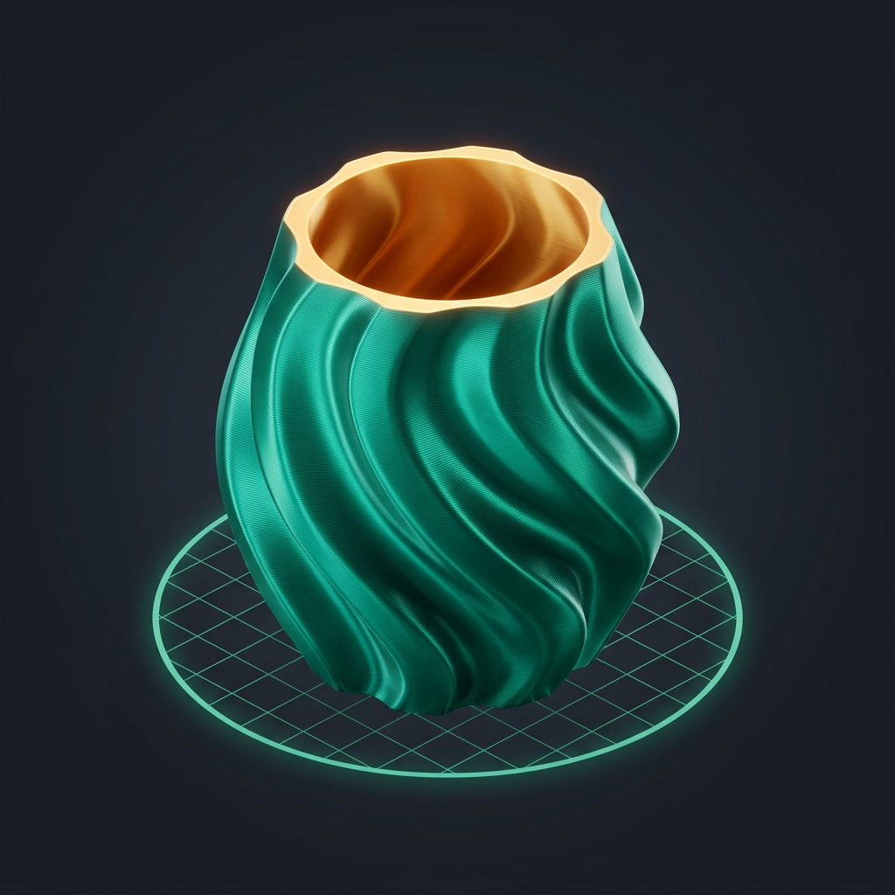

# Mini Manual de Uso — Orca Vase Studio (`v1.3.0`)

O seletor do cabeçalho oferece Português, English, Español, Italiano, Français, Deutsch e 日本語. A escolha é salva e sincronizada entre aba e painel; veja [idiomas e otimização](MULTILINGUAL_AND_PERFORMANCE.md).

  

> 🇺🇸 **Read in English:** [Quick User Manual (`MANUAL_EN.md`)](MANUAL_EN.md)

Bem-vindo ao **Orca Vase Studio**! Com este plugin nativo para o **OrcaSlicer 2.5.1+**, você modela vasos decorativos, vasos cerâmicos de parede espessa e cachepôs com drenagem e pratinho coletor em tempo real (100% offline) e envia tudo direto para a mesa de impressão em 1 clique.

---

## 1. Instalação Rápida

### Opção A — Instalação Local em 1 Clique (Arquivo Único `.py`)
1. Baixe o arquivo único **`orca_vase_generator.py`** (disponível na pasta `dist/` ou na aba [*Releases* do GitHub](https://github.com/victorFernande/orca-vase-generator/releases)).
   - *Não é preciso copiar mais nada: o plugin é 100% autossuficiente e gera automaticamente seu próprio ícone vetorial `icon.svg`!*
2. No **OrcaSlicer 2.5.1+**, abra o menu **Arquivo → Plugins → Instalar plugin local...** (*File → Plugins → Install local plugin...*) e selecione `orca_vase_generator.py`.
3. Acesse **Plugins → Gerenciar Plugins** (*Manage Plugins*), ative **Orca Vase Studio** e aprove as permissões locais de pasta do plugin (`fs_read`, `fs_readwrite` e `threading`).

### Opção B — Via OrcaSlicer Marketplace
1. No OrcaSlicer, acesse **Plugins → Marketplace** (ou **Gerenciar Plugins**).
2. Busque por **Orca Vase Studio**, clique em **Instalar** e habilite o plugin.

---

## 2. Como Abrir: Aba Superior vs. Painel Lateral Acoplado

O Orca Vase Studio oferece **dois modos de trabalho sincronizados** para combinar com o seu fluxo:

| Modo | Onde encontrar | Quando usar |
| :--- | :--- | :--- |
| **Aba Superior Completa (`Gerador de Vasos`)** | Na barra superior do OrcaSlicer, ao lado de *Preparar / Visualizar / Dispositivo* | Ideal para criar do zero em tela ampla de **3 colunas**: Galeria & Silhueta à esquerda, Viewport 3D interativo ao centro e Texturas + Parede à direita. |
| **Painel Lateral (`Orca Vase Studio - Painel Lateral`)** | Menu **Arquivo → Plugins → Orca Vase Studio - Painel Lateral** | Abre um estúdio compacto acoplado à direita da bandeja 3D (*Plater*) com abas rápidas (**Forma**, **Texturas**, **Impressão**, **Presets**) — ótimo para ajustar medidas olhando para a mesa! |

> **Dica:** Na barra superior do estúdio você também encontra o campo de **Nome do Vaso**, o indicador da sua **impressora/bico ativos** lidos automaticamente do OrcaSlicer, alternância de idioma (**PT / EN**), tema claro/escuro e o botão **Surpreenda-me** para gerar designs inéditos instantaneamente.

---

## 3. Modelando a Silhueta & Curva Livre 2D

Na seção **Silhueta & Curva 2D**, você escolhe como esculpir o corpo do vaso:

1. **Modo `Sliders` (Paramétrico Rápido):**
   - Ajuste diretamente **Altura Total** (`30–350 mm`), **Diâmetro da Base**, **Diâmetro e Altura do Bojo**, **Diâmetro e Altura da Cintura**, **Diâmetro do Pescoço**, **Abertura da Borda** (*Lip Flare*) e **Chanfro/Borda**.
   - Você também pode arrastar as alças coloridas diretamente no mini-gráfico 2D!
2. **Modo `Curva Livre 2D` (Interpolação Monotônica PCHIP):**
   - Clique em **`Sliders → Curva`** para converter sua silhueta atual em pontos editáveis, ou alterne direto para **Curva Livre 2D**.
   - **Arraste** qualquer nó para remodelar o raio e a altura; **clique sobre a curva** para adicionar um novo nó; **duplo-clique** (ou **botão direito**) em um nó intermediário para removê-lo.
   - A curva usa matemática **PCHIP**, garantindo transições orgânicas suaves sem "calombos" ou oscilações artificiais.
3. **Seção Poligonal & Resolução:**
   - Em **Lados do Polígono**, `0` mantém o vaso circular; valores de `3` a `24` criam prismas triangulares, hexagonais, octogonais ou facetados, com **Suavidade dos Cantos** ajustável de `0` (quinas vivas) a `1` (circular).

---

## 4. Personalizando as Texturas Combináveis

**Relevo geométrico:** abra essa nova camada para escolher losangos, escamas,
crateras, pétalas dobradas, flor em espiral, anéis ou coral. Ajuste profundidade,
colunas, fileiras, torção e a intensidade na base, no meio e no topo.
Desligue os outros efeitos para isolar o padrão ou combine as camadas.
Veja os [controles, limites e testes](GEOMETRIC_PATTERNS.md).

**Pétalas dobradas** gera fitas enroladas em volta de um vaso interno redondo
e oco. Ajuste largura, espessura, curvatura, sobreposição, estiramento e
alternância; escolha qualidade Rascunho, Normal, Fina ou Adaptativa. Fina é
o padrão final. O modo espiral e as outras texturas ficam indisponíveis.
Confira os sólidos sobrepostos na prévia fatiada; a estimativa inclui as
sobreposições.

Você pode ativar **uma ou várias camadas de textura ao mesmo tempo** — os relevos são somados matematicamente em milímetros com paridade exata entre o 3D da tela e a malha final!

Antes das camadas, ajuste o **Envelope & Torção Global**:
- **Suavização na Base / no Topo (`mm`):** Faz a textura nascer suavemente a partir de `0 mm` na base (garantindo fundo 100% plano e firme na mesa aquecida) e suavizar na borda superior.
- **Torção Helicoidal (`-720°` a `+720°`):** Gira toda a geometria e as texturas em espiral ao longo da altura.

### Controles Dimensionais de Cada Textura

1. **Canelado / Frisos (`Ribbed`):**
   - *Profundidade do Friso (`mm`):* Altura positiva (relevo externo) ou negativa (sulcos cavados).
   - *Quantidade (Densidade):* Número de frisos ao redor do vaso (`3` a `180`).
   - *Largura vs. Espaçamento (`Duty Cycle`):* Proporção entre a largura da coluna e o intervalo plano entre elas.
   - *Nitidez da Crista:* De `0.0` (ondas senoidais macias) até `1.0` (arestas triangulares lapidadas) + *Torção dos Frisos* independente.
2. **Ondas Orgânicas (`Organic Waves`):**
   - *Amplitude da Onda (`mm`)* e *Comprimento Vertical (`mm`)* (distância vertical entre cristas).
   - *Lóbulos na Volta:* Quantas ondulações contornam a circunferência (`0` cria anéis horizontais puros de torno cerâmico!).
   - *Interferência Cruzada:* Mistura uma contra-onda helicoidal criando tramas e almofadas orgânicas.
3. **Origami Diamante (`Yoshimura`):**
   - *Relevo dos Diamantes (`mm`)*, *Células Horizontais* e *Andares Verticais*.
   - *Vincos Dobrados (`Sharpness`):* Define o quão marcadas são as dobras do papel + *Deslocamento (`Stagger`)* entre fileiras.
4. **Celular / Coral 3D (`Cellular`):**
   - *Relevo Celular (`mm`)*, *Células na Volta* e *Escala Vertical (`mm`)*.
   - *Veios em Crista (Coral):* Ligado cria nervuras orgânicas de recife/pedra vulcânica; desligado cria relevo cerâmico martelado suave (*wabi-sabi*), com *Semente (`Seed`)* personalizável.

---

## 5. Inspecionando com `🔬 Raio-X`, `💿 Fatia Z` & Mapa de Overhang

Na barra flutuante do Viewport 3D, você conta com ferramentas dignas de CAD para validar sua peça antes de imprimir:

- **`🔬 Raio-X / Parede`:** Ativa o shader translúcido de dupla camada que revela a cavidade oca interna e a espessura real do fundo em tom âmbar quente por dentro da parede esmeralda externa.
- **`📏 Cotas mm` (Calibre CAD):** Projeta cotas milimétricas em tempo real sobre o vaso: **`Ø Externo`**, **`Ø Furo` (abertura interna da boca)**, **`Parede`** e **`Fundo`**.
- **`✂ Corte Transversal` (`Perfil Y` e `💿 Fatia Horizontal Z`):**
  - **Corte Vertical (`Perfil Y`):** Corta o vaso ao meio verticalmente para inspecionar todo o perfil interno da parede do fundo até a boca.
  - **`💿 Fatia Horizontal Z (Planta 5%–100%)`:** Deslize o controle de altura para fatiar o vaso horizontalmente como uma tomografia e ver a espessura exata do anel de parede e dos frisos em qualquer altura `Z`!
- **`🔥 Overhang` (Mapa Térmico em Graus):** Colore a superfície conforme o ângulo de inclinação em relação à mesa (verde = seguro, âmbar = atenção, vermelho = crítico). Se alguma textura ficar íngreme demais, marque **Limitar Overhang Automaticamente** na aba *Impressão* para suavizar apenas as inclinações excessivas!

---

## 6. Vaso Oco Real (`mm`) vs. Modo Espiral

Na seção **Parede & Abertura (mm)**, escolha a estrutura física da peça:

### Vaso Oco Real (`Parede em mm`) — *Padrão Recomendado*
- Gera uma **malha oca real com boca aberta no topo** e parede interna concêntrica estanque.
- Permite ajustar **Espessura da Parede (`0,8 mm` até `25,0 mm`)** e **Espessura do Fundo (`1,0 mm` até `25,0 mm`)** — perfeito desde vasos leves de 2 voltas até vasos arquitetônicos espessos estilo cerâmica!
- Mostra automaticamente quantas voltas do seu bico atual formam aquela parede e o diâmetro livre do furo da boca.

### Modo Espiral (`1 Linha` / *Vase Mode*)
- Ideal para impressões ultrarrápidas e sem costura Z usando uma única linha contínua da extrusora (`0,40–1,20 mm`).
- **Como funciona no fatiador:** Para o fatiamento espiral nativo (`.3MF` / envio direto à mesa), o OrcaSlicer exige um bloco base maciço cujo topo é removido automaticamente pelo próprio fatiador (`top_shell_layers = 0`, `sparse_infill_density = 0%`).
- **Proteção de Boca Aberta no `.STL`:** A opção **`Manter boca aberta ao exportar .STL`** vem **ativada por padrão**! Assim, mesmo se você estiver no Modo Espiral e clicar em `Exportar .STL`, o arquivo `.STL` salvo terá boca aberta e parede oca real — evitando surpresas ao abrir o `.STL` em outros programas.

---

## 7. Jardinagem: Furos de Drenagem & Pratinho Coletor

Transforme qualquer vaso em um cachepô botânico pronto para terra e plantas naturais:

1. **Furos de Drenagem na Base (`1` a `9` furos):**
   - Ajuste quantidade, diâmetro (`3–20 mm`) e raio do anel de furação.
   - *No Vaso Oco Real:* Cria túneis cilíndricos estanques atravessando o fundo.
   - *No Modo Espiral:* Cria **cavidades cegas inteligentes** exatamente na altura das camadas sólidas da base — garantindo furos reais de escoamento de água sem quebrar o contorno único da espiral!
2. **Incluir Pratinho Coordenado (`🍽 Pratinho`):**
   - Gera automaticamente um prato coletor sob medida para a base do seu vaso, com folga radial ajustável, **nervuras internas elevadas** (para a água escoar sob o vaso sem apodrecer as raízes) e opção de **Repetir Textura do Vaso no Prato**.
   - Use o botão `🍽 Pratinho` no Viewport 3D para pré-visualizar o conjunto **Encaixado** ou **Lado a Lado**.
   - *Nota automática:* Ao enviar ou exportar **Vaso + Pratinho juntos**, o plugin usa automaticamente **Vaso Oco Aberto** (já que dois objetos na mesma bandeja não podem ser impressos em Modo Espiral simultâneo).

---

## 8. Envio em 1 Clique para a Mesa & Exportação (`.3MF` / `.STL`)

No rodapé do painel direito, você tem três ações imediatas:

1. **`Enviar para a Mesa do OrcaSlicer` (Botão Principal):**
   - Gera a malha de alta precisão e injeta o vaso (e o pratinho, se marcado) **diretamente na bandeja ativa do OrcaSlicer**, alternando automaticamente para a aba *Preparar*.
   - Com **`Auto-ajustar OrcaSlicer ao enviar`** ativo, o plugin configura sozinho os parâmetros ideais do processo (`Modo Espiral`, `Voltas de Parede`, `Camadas Inferiores`, `Largura de Linha Externa`, etc.) sem travar a interface!
2. **`Exportar .3MF`:**
   - Salva um projeto completo compatível com o OrcaSlicer 2.5.1 preservando sua impressora e filamento atuais + configurações ideais do vaso (e posiciona vaso + pratinho lado a lado sem colisão).
3. **`Exportar .STL`:**
   - Salva arquivos binários `.STL` 100% estanques (*2-manifold watertight*) prontos para compartilhamento no Printables, MakerWorld ou qualquer outro fatiador.
   - Clique no ícone de **Pasta 📁** ao lado dos botões de exportação a qualquer momento para abrir diretamente a pasta onde seus arquivos foram salvos!
