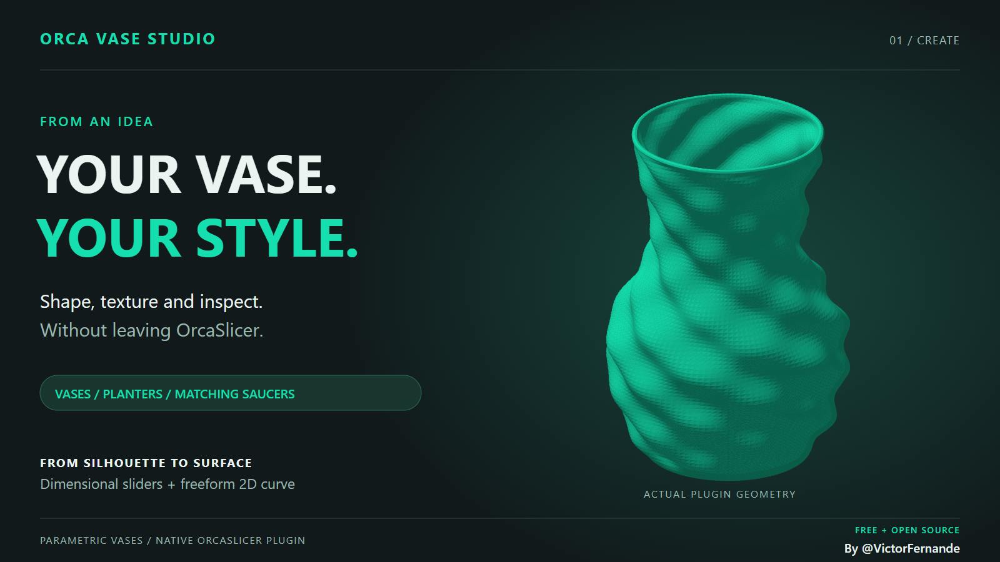
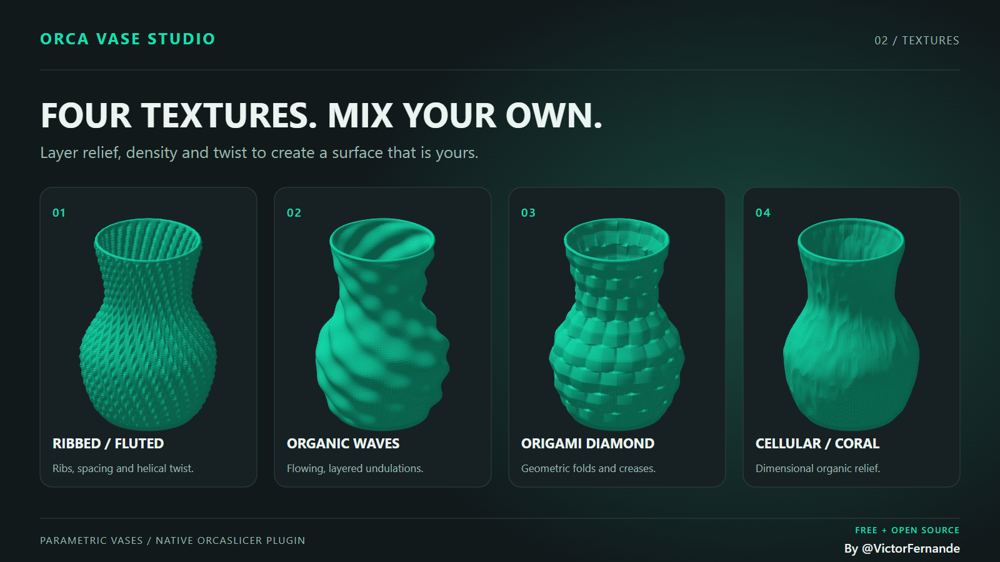
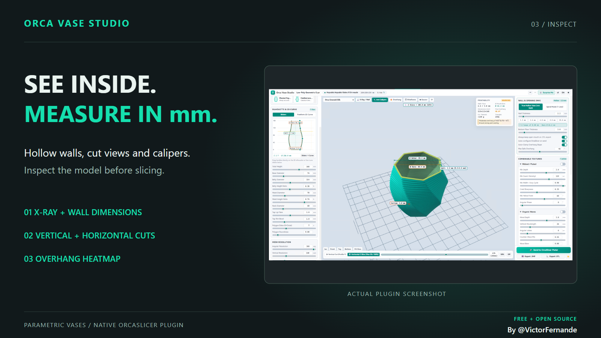
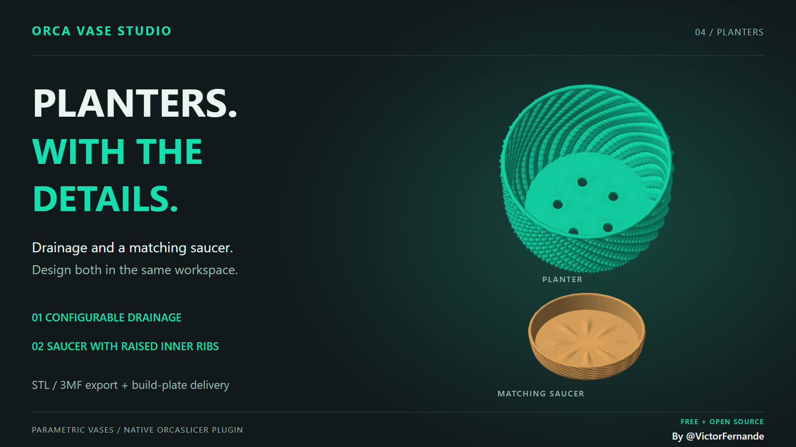

**Your vase. Your style. Without leaving OrcaSlicer.**

Create vases and planters offline with dimensional sliders or a **freeform 2D profile**. Start with 12 presets, try Surprise Me or save your own design.

## Four textures to combine

Mix **ribbed/fluted, organic waves, origami diamond and cellular/coral**. Adjust relief, density, twist and fade zones to build your own surface.

## See inside. Measure in millimeters.

Choose **hollow walls or Spiral Vase mode**. Inspect the opening, wall and floor with X-Ray, millimeter calipers, vertical/horizontal cuts and the overhang heatmap.

## Planters with the details

Configure drainage holes and a matching saucer with raised inner ribs. Export **STL / 3MF** or send the objects to the build plate, with optional slicing suggestions.

## Get started

1. Install and activate in **OrcaSlicer 2.5.1+**, then restart it.
2. Open the Vase Studio tab or dock, choose a preset and adjust it.
3. Inspect the model, export or send to the plate, and review slicing settings.

Interface in English and Portuguese. Preview diagnostics assist inspection; printing results depend on material, orientation and printer settings.
