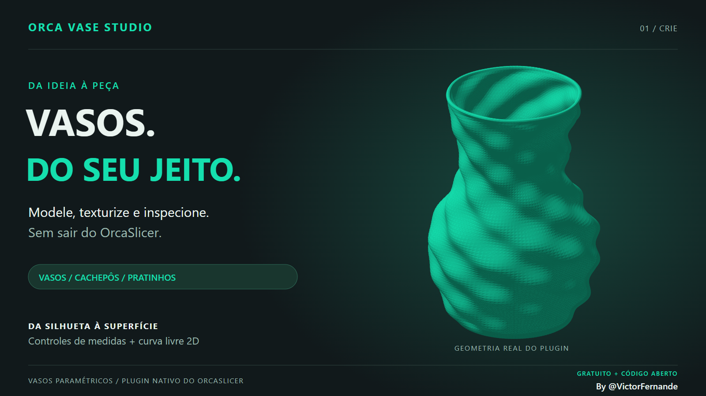
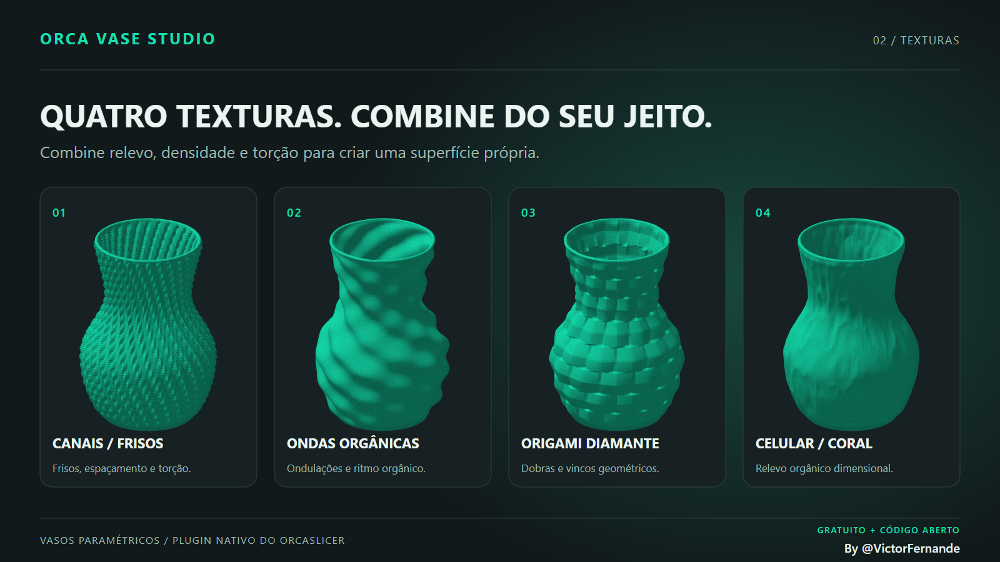
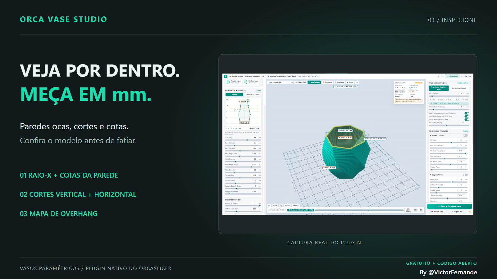
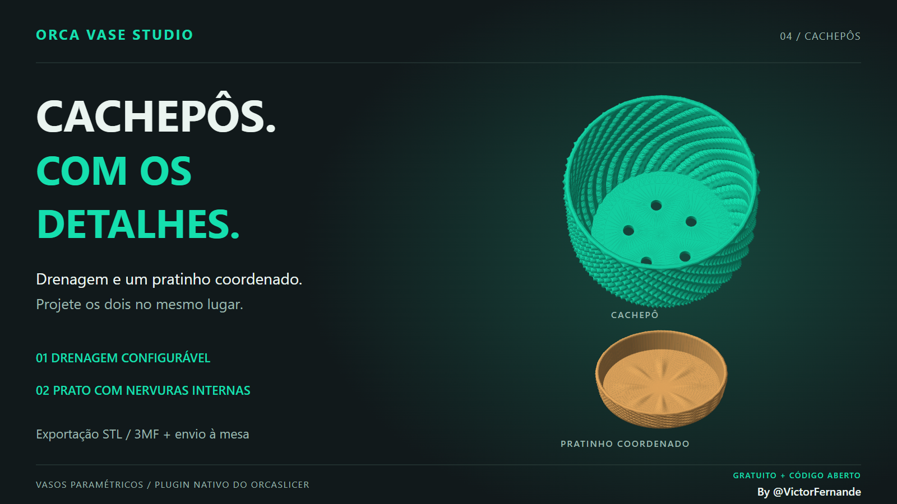

**Vasos do seu jeito. Sem sair do OrcaSlicer.**

Crie vasos e cachepôs offline com controles de medidas ou **curva livre 2D**. Comece com 12 presets, use Surpreenda-me ou salve seu próprio modelo.

## Quatro texturas combináveis

Misture **canais/frisos, ondas orgânicas, origami diamante e celular/coral**. Ajuste relevo, densidade, torção e suavização nas extremidades para criar sua superfície.

## Veja por dentro. Meça em milímetros.

Escolha **parede oca ou Modo Espiral**. Confira abertura, parede e fundo com Raio-X, cotas em milímetros, cortes vertical/horizontal e mapa de overhang.

## Cachepôs com os detalhes

Configure a drenagem e um pratinho coordenado com nervuras internas. Exporte **STL / 3MF** ou envie os objetos à mesa, com sugestões opcionais de fatiamento.

## Como começar

1. Instale e ative no **OrcaSlicer 2.5.1+** e reinicie o aplicativo.
2. Abra a aba ou o painel do Vase Studio, escolha um preset e ajuste.
3. Inspecione o modelo, exporte ou envie à mesa e revise o fatiamento.

Interface em português e inglês. Os diagnósticos auxiliam a inspeção; a impressão depende do material, da orientação e das configurações da impressora.
